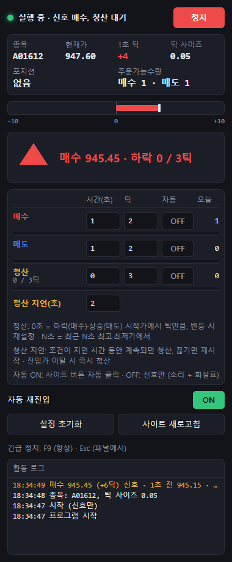

# Tick Trader

A Windows desktop app that watches a web trading terminal and reacts to fast price moves. It reads the price straight from the page, counts how many ticks the price moved in the last second, and when your conditions are met it either clicks the site's own market order buttons or just gives you a signal (a sound and a blinking arrow).

It was built for a client who trades index futures through a broker that only offers a web terminal, with no API. The broker site is left untouched: it runs on the left side of the window, and the program's settings panel sits on the right.



## How the signals work

All tick values are in the instrument's minimum price step. "1-second ticks" means the current price minus the price exactly one second ago, recalculated on every price update.

### Buy and Sell

Each has a time and a tick setting. With 2 s / 5 ticks, a Buy fires when the 1-second change stays at +5 or more for two seconds in a row. If it drops below +5 even once, the timer starts over. Sell is the mirror image (−5 or less). At 0 seconds the signal fires the moment the threshold is reached.

### Close

Close is measured in price from the entry, not in 1-second ticks:

- 0 s / N ticks: after a Buy, close when the price has fallen N ticks from the point where the current fall began. Any rise, even one tick, moves that point up. The count starts at the entry price.
- S s / N ticks: close when the price is N ticks below the highest price of the last S seconds (never looking back past the entry).
- Close delay: the condition has to hold for this many seconds without a break before the position is closed. A break resets the delay.
- If the price crosses the entry price against the position, the program closes at once, whatever the delay says.

After a Sell everything is reversed.

### One position at a time

After a Buy or Sell nothing new can open until a Close. In signal-only mode the program keeps its own virtual position, so Close works without a real one. If the site shows a real position (opened by hand or by the program), that one wins, and a close on the site (manual, stop-loss, take-profit) counts as the Close.

## What else it does

- Each action (Buy, Sell, Close) has its own ON/OFF switch. OFF means signal only. Turning one ON asks for confirmation, and a red banner stays up while any real orders are possible.
- After a click, further actions wait until the position on the site changes (up to 5 seconds), so one move never sends two orders.
- If the price freezes for 30 seconds (logout, lost feed, market closed), signal-only mode pauses and picks up again by itself. With any auto order switched on, it stops and waits for Start.
- F9 stops everything, even when the window is in the background.
- Signals are marked on the site's own TradingView chart with small outlined triangles.
- No orders are clicked when the account has no buying power left.

## Logs

Everything is written to `%APPDATA%\Tick Trader\logs`, one set of files per day:

- `YYYY-MM-DD.log`: the activity log shown in the panel. Each signal line carries the prices and values behind it.
- `signals-YYYY-MM-DD.csv`: one row per signal with the full calculation (price a second ago, ticks, threshold, how long the condition held, the high or low Close was measured from, why it closed).
- `prices-YYYY-MM-DD.csv`: every price update from the page, with millisecond timestamps.

The price file is there for disputes. When a signal looks wrong, feed that stretch of prices back into the engine and you get exactly what the program saw.

## Project layout

```
src/engine/    signal logic with no Electron dependency: price window, rule engine, daily counters
src/preload/   site.ts is the only file that knows the terminal's markup; panel.ts is the panel bridge
src/main/      window, IPC, the 50 ms loop, logs, settings, chart markers
src/panel/     the settings panel (plain HTML, CSS and TypeScript)
src/shared/    IPC channels and message types
test/          engine and chart marker tests, plus a mock terminal page
```

The window is an Electron `BaseWindow` with two `WebContentsView`s. The site runs in its own persistent session with background throttling off, so the order book keeps updating while the window is minimised.

## Running it

```bash
npm install
npm test            # engine and marker tests
npm run typecheck
npm start           # build and launch
npm run dist        # portable Windows exe in release/
```

On first start, enter the terminal's address in the panel (사이트 주소) and log in on the left side. The login is never stored by the program.

### Without a real account

`test/fixtures/mock-site.html` copies the terminal's markup: an order book with a moving price, the three order buttons, the tick size table and a position cell. Point the app at it with environment variables:

```bash
TT_USER_DATA=/tmp/tt-mock TT_SITE_URL="file:///path/to/test/fixtures/mock-site.html" TT_AUTOSTART=1 npm start
```

The mock takes a few query parameters: `?trend=up|down` adds drift, `?freeze=10&thaw=40` stops the price for a while, `?margin=0` empties the buying power.

## Stack

Electron 44, TypeScript, esbuild, vitest, electron-builder. The panel uses no framework.

## Notes

The UI text is in Korean because that is what the client reads. The site adapter in `src/preload/site.ts` is written for one specific terminal; pointing the app at another site means rewriting that file.
